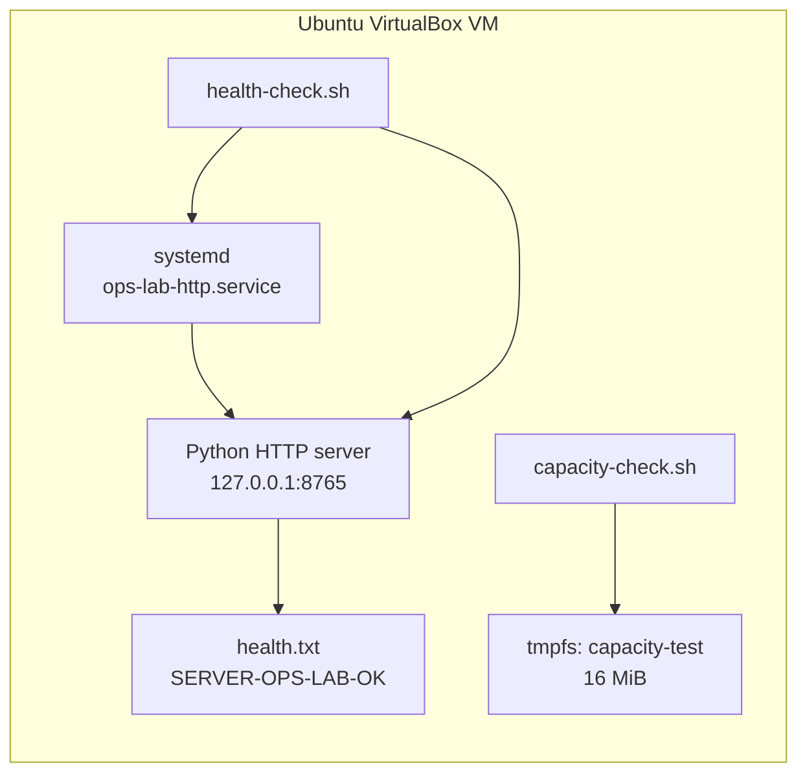
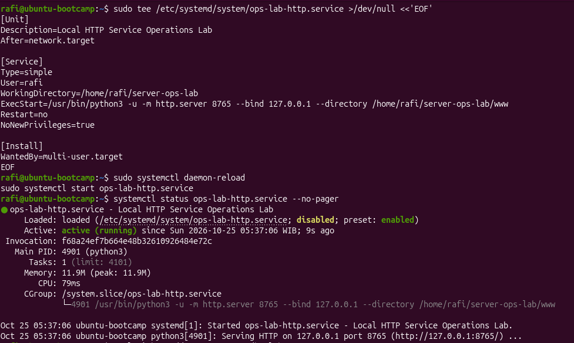
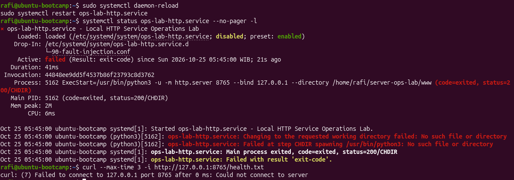
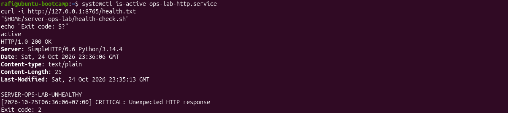
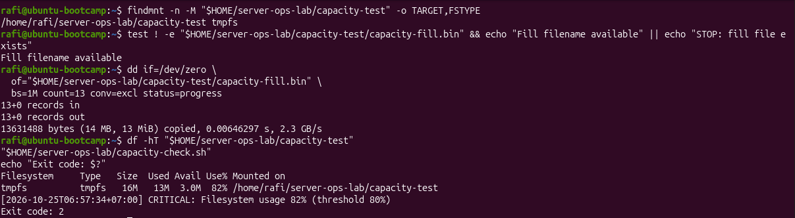

# Linux Server Operations & Incident Management Lab

An evidence-driven Linux operations exercise covering service deployment, configuration fault isolation, system logs, endpoint health checks, and capacity threshold alerts inside a single isolated Ubuntu virtual machine.

**Lab date:** 25 October 2026 (WIB)  
**Platform:** Ubuntu 26.04 LTS on Oracle VirtualBox  
**Scope:** Local virtual lab, not production infrastructure  
**Result:** Tested service failures and a simulated capacity warning were detected and recovered; 34 original terminal screenshots document the work.

## At a glance

| Area | What was tested | Observed result |
|---|---|---|
| System inventory | CPU, RAM, filesystems, installed tools, software RAID status | 2 vCPUs; 5.3 GiB RAM; root filesystem 65% used; `/dev/md0` RAID1 `[UU]` at baseline |
| Service baseline | Python HTTP server managed by `systemd` on loopback | `active (running)`, TCP `127.0.0.1:8765` listening, HTTP `200 OK`, expected health text |
| Startup fault isolation | Deliberately invalid `WorkingDirectory` in a systemd drop-in | `failed`, `status=200/CHDIR`, `No such file or directory`; logs and unit config identified the cause |
| Service recovery | Disable faulty drop-in, reload and restart only the test unit | `active (running)`, HTTP `200 OK`, expected body, TCP listener restored |
| Health-check scripting | Check service status and exact HTTP content | Healthy exit `0`; stopped service exit `2`; wrong content with HTTP `200` exit `2`; both recovered |
| Capacity alert | 16 MiB memory-backed `tmpfs`, 80% threshold, 13 MiB controlled test write | 82% usage triggered `CRITICAL` exit `2`; removal returned to 0% and exit `0` |

The table summarizes **observed point-in-time checks**, not continuous availability or real-world production reliability.

## Lab architecture

The test server listened on **loopback only** (`127.0.0.1`), not a public network interface. The capacity test used a separate, small `tmpfs` mount so it did not intentionally fill the Ubuntu system disk or the RAID1 array created in an earlier lab.

## Selected evidence

### 1 — Service started correctly

Baseline service evidence: [HTTP `200 OK` and listening port](evidence/03c-http-and-port-check.png).

### 2 — Investigating a failed service

The deliberate invalid working-directory override prevented process startup. Diagnosis combined [unit configuration](evidence/05a-service-override.png), [journal messages](evidence/05b-journalctl-chdir-error.png), and [a missing-directory check](evidence/05c-directory-missing.png). After reverting the override, [HTTP responses](evidence/06d-http-recovered.png) and [TCP listening status](evidence/06e-port-listening.png) were verified.

### 3 — Detecting unhealthy responses even when HTTP is `200`

The script checks **expected application content**, not merely whether a process exists or the HTTP status is 200. The endpoint body was [restored and tested](evidence/11b-http-health-check-reverified.png).

### 4 — Capacity alert and recovery

Deleting the disposable test file returned the same filesystem to [0% usage and an OK check](evidence/15-capacity-recovered.png).

All **34 original screenshot files**, with per-image interpretation and limitations, are catalogued in the [evidence index](evidence/README.md). They are preserved as originally provided; none were generated or edited to imitate terminal output.

## Incident flow

1. **Establish a baseline:** inventory system state; start the isolated service; test `systemctl`, `curl`, and `ss`.
2. **Introduce a controlled fault:** override the lab service's `WorkingDirectory` with a path that does not exist.
3. **Find the root cause:** use `systemctl cat`, `journalctl`, and a filesystem-path check to explain `200/CHDIR`.
4. **Recover:** disable only the test override; reload systemd; start the unit; verify status, HTTP response and port.
5. **Validate the monitor:** run the Bash script during healthy service, inactive service, incorrect HTTP content, and restored service.
6. **Validate capacity alerting:** create a 13 MiB file only inside a verified 16 MiB `tmpfs`, cross the 80% threshold, then remove the file and retest.

The test service and its `tmpfs` are not meant to be a hardened production setup. They were chosen for controlled, limited-scope experimentation.

## Repository contents

| Path | Purpose |
|---|---|
| [`incident-report.md`](incident-report.md) | Root-cause analysis, observed effects, corrective actions and verification |
| [`commands.md`](commands.md) | Reproducible command reference with safety guards and an optional cleanup procedure |
| [`monitoring/health-check.sh`](monitoring/health-check.sh) | Manual systemd + HTTP-content health check |
| [`monitoring/capacity-check.sh`](monitoring/capacity-check.sh) | Manual `tmpfs` usage alert at 80% |
| [`service/ops-lab-http.service`](service/ops-lab-http.service) | Example systemd unit reconstructed from the visible exercise |
| [`service/health.txt`](service/health.txt) | Expected response content |
| [`asset-inventory.csv`](asset-inventory.csv) | Recorded VM inventory, including evidence references |
| [`procedures/troubleshooting-sop.md`](procedures/troubleshooting-sop.md) | Step-by-step, read-only-first troubleshooting procedure |
| [`procedures/shift-handover.md`](procedures/shift-handover.md) | Simulated operational handover and open housekeeping items |
| [`evidence/`](evidence/) | Original screenshots, inventory and SHA-256 manifest |

## How to review or reproduce

Read the [commands reference](commands.md) from top to bottom. **Do not run setup or fault-injection snippets on production systems**, and do not repeat setup commands if these units, directories, or mounts already exist. Files in `monitoring/` reproduce the logic visible in the original screenshots, but **were reconstructed for this repository rather than directly exported from the VM**. For authenticity, the source screenshots show the commands entered and resulting outputs.

## Scope, accuracy, and open items

- This is a **single-VM, local-only Linux lab**. It does not show physical server repair, remote management via BMC/IPMI, real operational ticket systems, or a live customer incident.
- Python's built-in `http.server` is a deliberately minimal test endpoint, not a production web application.
- Checks were **manually invoked**; no recurring monitoring schedule, alert delivery service, uptime SLA, or stress test was implemented.
- The capacity threshold was an exercise policy, not a facility-defined operational standard. The script's `exit 3` missing-mount error path is coded but **not evidenced as executed**.
- The test file's removal and return to 0% capacity are evidenced. The operator **later reported completing the `tmpfs` unmount**, but did not submit terminal output of `umount` or the final mount-state check. This housekeeping action is therefore **user-reported, not independently verified from screenshot evidence**; the safe teardown instructions are in `commands.md`.
- Array status `/dev/md0 [2/2] [UU]` was observed at the initial inventory; it was not reverified at every stage. This project did not modify the RAID.
- The original failed backup/restore attempt during the HTTP content fault remains documented in the [incident report](incident-report.md). Successful recovery used a direct restoration of the known-good response.
- Spreadsheet-based facility audit and availability models are **outside this repository's scope**. No completed Excel exercises or facility assessments are claimed.

## Key lessons

A running process is not the same as a healthy endpoint; a healthy HTTP status does not necessarily mean correct content; and an alarm is only useful when its measurement target is validated. Recording the **failure, the diagnosis and the independent post-recovery check** makes troubleshooting reviewable and repeatable.
